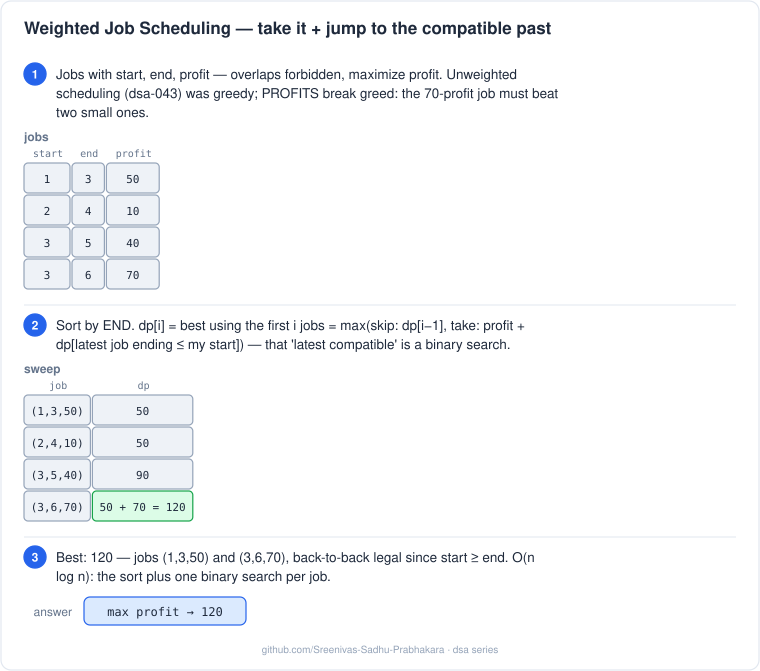

# Maximum Profit in Job Scheduling

> Striver SDE Sheet 184 · Day 26 DP II — weighted interval scheduling: sort by end, binary-search each job's latest compatible predecessor, take or skip. Go, stdlib only, tested.

## Problem

Jobs with start, end and profit; pick a non-overlapping subset maximizing total profit. The weighted upgrade of N-meetings (#043) — and the weight is exactly what kills the greedy: a short cheap job can block a long lucrative one.

## Approach

Sort by end time; let `dp[i]` be the best profit among the first i jobs. Job i's decision is binary: skip it (`dp[i−1]`) or take it — its profit plus the best schedule among jobs ending **by its start**, found by binary-searching the sorted end times (`SearchInts(ends, start+1)` gives "latest end ≤ start", touching allowed). Sorting by end is what makes "compatible predecessors" a *prefix*, so one dp array over sorted order captures everything. The structure is DP-over-sorted-events + binary search — the same recipe behind stock problems with cooldown and "maximum events attendable".

**Complexity:** O(n log n) time, O(n) space.

## Visual walkthrough

Read the picture top to bottom — each numbered frame is one moment of the algorithm
running on this repo's test example.

## Run

    go test ./...   # verify
    go run .        # demo

---

One of 191 repos solving Striver's SDE Sheet in Go — stdlib only, one problem per repo, every solution tested. Browse the set: [`dsa-*` repos](https://github.com/Sreenivas-Sadhu-Prabhakara?tab=repositories&q=dsa-&type=source).
